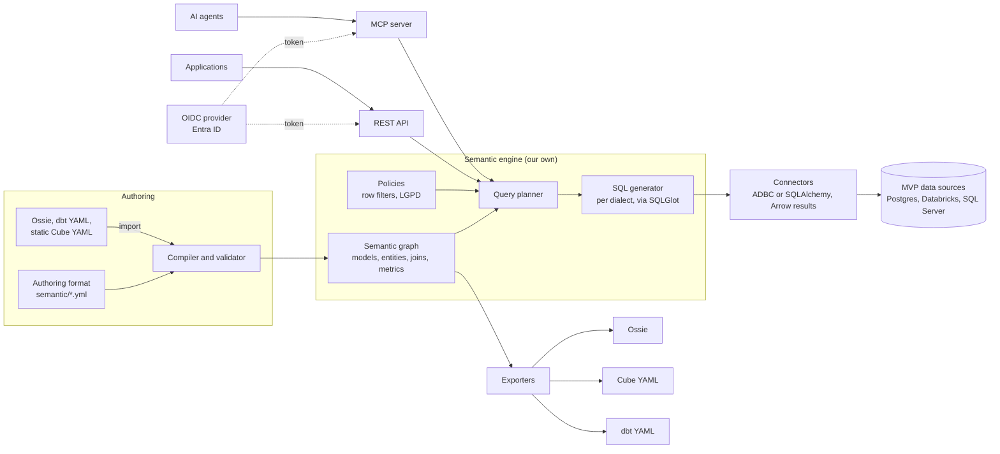

# Architecture

The semantic engine is our own: it reads the model, plans each metric query, generates SQL in the data source's dialect and runs it there. Cube, dbt and Ossie are import and export formats. See [ADR 0004](decisions/0004-own-semantic-engine.md) and [ADR 0007](decisions/0007-connectors-sources-identity-and-import.md).

## Overview



## Components

| Component | Responsibility | Technology |
| --- | --- | --- |
| Authoring format | Where users model entities, dimensions, measures and metrics | YAML in git, versioned (`version: 1`), with the dbt vocabulary; see [semantic model](semantic-model.md) |
| Compiler and validator | Reads and validates the model, infers joins from entities and builds the semantic graph | Python, Pydantic; the format's JSON Schema is generated from the Pydantic models |
| Ontology | SKOS glossary (concepts, synonyms, hierarchy) and business rules bound to models | Part of the semantic graph; see [ADR 0006](decisions/0006-ontology-in-the-mvp.md) |
| Rule tests | Run each business rule's examples in CI, without touching the data source | SQLGlot translating to DuckDB |
| Query planner | Turns a request (metrics, dimensions, filters, time grain) into a logical plan | Python; MetricFlow as a design reference |
| SQL generator | Turns the plan into SQL in each source's dialect | [SQLGlot](https://github.com/tobymao/sqlglot) (MIT) |
| Connectors | Run read-only SQL and always return Arrow results | Our own `Connector` interface; ADBC by default, SQLAlchemy as the fallback for sources without a mature ADBC driver |
| Policies | Row filters from the user context and LGPD rules for sensitive columns | Part of the semantic model |
| REST API | Queries from applications | FastAPI |
| MCP server | Metadata and queries for AI agents | Official MCP SDK, HTTP transport |
| Interchange | Import dbt (latest and legacy), Ossie and Cube (static YAML); export Ossie, Cube and dbt | Python; see [interoperability](interoperability.md) |

## Query planner

The planner is the most delicate part of the product, because it is where a number can come out wrong.

**Input:** a request such as "revenue and average order value by customer region, by month, in 2026".

**Steps:**

1. **Resolve names:** each metric, dimension and filter in the request becomes a member of the semantic graph. Business terms go through the glossary: a synonym leads to the concept, and the concept leads to the member or business rule that defines it.
2. **Find the join path:** starting from the model that owns each measure, follow entities to the models of the requested dimensions, across several hops if needed. An ambiguous path is an error, never a silent choice.
3. **Avoid row multiplication (fan-out):** when measures from different models appear together, each one is aggregated at its own grain, in a subquery, before the results are joined on the shared dimensions. This is the same strategy as MetricFlow.
4. **Apply policies:** row filters from the user context enter the plan; columns marked as sensitive can only appear aggregated.
5. **Generate SQL:** SQLGlot turns the plan into the source's dialect, including date truncation per grain.
6. **Run and cap:** the connector runs the query with configurable row and time limits.

## Engine behaviors the model must take into account

- **A row filter applies where its model participates.** The `customers` filter only applies when `customers` is part of the query. To restrict orders by the customer's region even without grouping by customer, declare the filter on `orders` referencing `{customers.region}`; the engine adds the needed join.
- **Dimensions on the "many" side are attributed, never multiplied.** Each measure starts at its model and reaches "one"-side dimensions through many-to-one joins. A dimension on the "many" side (for example, product category for order revenue) goes through a **bridge**: distinct pairs of the measure's key and that dimension, built from a model that reaches both (here `order_items`). Each order counts once in every category it contains, so totals across categories can exceed the overall total; the evidence envelope says so. A filter on the "many" side (`{products.category} = 'Home'`) means "orders containing a Home item". When no model links the two sides, or several do, the request is refused with an explanation. For per-item amounts, use the measure of the detailed model (`item_revenue` on `order_items`).
- **Joining through a dimension spine.** Measures from different models are aggregated in separate CTEs and joined through the union of their dimension combinations, with null-safe equality. Derived metrics follow SQL semantics: if one of the measures has no value for a combination, the result is null.
- **Business rules inherit the LGPD classification** of the columns they use; a rule over sensitive data is also denied to agents.
- **One query at a time per process** in the API and MCP; for more throughput, run more replicas in Container Apps.
- **Same model, different schemas:** `schema_map` on the connection renames table schemas per source (for example `public: dbo` on SQL Server).

## Same number on every data source

The advanced reference suite and a randomized cross-database test (80 random requests compared across DuckDB, Postgres and SQL Server) pin down these guarantees:

| Guarantee | Why it is needed |
| --- | --- |
| Division in derived metrics is real and safe against zero | Postgres and SQL Server do integer division between integers and fail on zero |
| `AVG` is a real average | SQL Server truncates the average of an integer column; Postgres returns `NUMERIC` |
| Weeks start on Monday (ISO) | SQL Server weeks depend on `DATEFIRST` |
| Nulls sort last, ascending or descending | Each database has a different default |
| Booleans work as values and as conditions | SQL Server has no boolean values: predicates become `CASE` when selected |
| `CURRENT_DATE` is the business date | Each server has its own clock and time zone; the engine writes the reference date (model `timezone`, or the request's `as_of`) into the SQL, which also makes queries reproducible |
| Postgres `NUMERIC` arrives as an exact decimal | The ADBC driver returns it as text |
| SQL Server identifiers are bracketed and grouping uses expressions | `public` is a reserved word and `GROUP BY 1` is not accepted |

## Performance baseline

`examples/tpch` models the TPC-H schema (line items, orders, customers, nations, regions and parts) with measures such as revenue (`l_extendedprice * (1 - l_discount)`), a ratio across two grains and the promotional revenue share of TPC-H Q14. Its `queries.yml` holds seven requests with hand-written SQL in the format of `reference/`, so the model is a second reference case: `tests/test_tpch.py` checks them in the default run on DuckDB at scale factor 0.01. The requests borrow the shapes of TPC-H queries (joins, grains, filters); only one of them is exactly a TPC-H query (Q14). The values change with the scale factor; the engine must equal the hand-written SQL at every one.

The baseline times the same requests on DuckDB's TPC-H data at scale factor 1: for each one, the time to compile the request, to run the engine's SQL and to run the hand-written SQL (the best of three runs), and it fails if the two results differ. It is opt-in, behind the `perf` marker, and prints a table at the end:

```bash
uv run pytest -m perf tests/perf            # scale factor 1
COSMOS_TPCH_SF=0.1 uv run pytest -m perf tests/perf
```

The default run excludes it through `addopts = ["-m", "not perf"]` in `pyproject.toml`. A `-m` given on the command line replaces that filter instead of adding to it, so combine them explicitly when selecting other markers, for example `uv run pytest -m "not perf and not snowflake"`.

The data comes from `CALL dbgen(sf=...)` in DuckDB's `tpch` extension, which DuckDB downloads once; without network access the TPC-H tests are skipped. Set `COSMOS_REQUIRE_TPCH=1` to make them fail instead, in a run that must not lose them silently. Only DuckDB for now; the other databases come in later slices.

## Evidence envelope

Every answer (REST, MCP and `cosmos query --evidence`) carries an `evidence` envelope ([ADR 0008](decisions/0008-verifiable-numbers-as-phase-2-differentiator.md)):

| Field | Contents |
| --- | --- |
| `query_id` | Identifier of the audited query |
| `model_hash`, `engine_version` | Exact version of the semantic model and of the engine |
| `as_of`, `timezone` | The business date used for `CURRENT_DATE` |
| `data_source`, `principal` | Where the query ran, and who asked through which channel, with the user context |
| `metrics` | Each metric expanded down to aggregations over model columns, its measures and glossary concepts |
| `rules` | Business rules used (as filter or value), with owner, effective date, logic and test status |
| `policies` | Row filters applied, the user context values they used and the CTEs they applied to |
| `lineage` | Models and joins involved |
| `sql`, `result` | Generated SQL and its hash; row count and an order-independent result hash |
| `caveats` | What the evidence does not prove, such as untested rules or the reproducibility limit |

With `COSMOS_AUDIT_LOG` pointing to a `.jsonl` file, every query is recorded with its hashes, and `cosmos replay <query_id>` (or `POST /v1/replay/{query_id}` and the MCP tool `replay`, only for the user who ran it) re-runs it with the same request, user context and `as_of`. The verdict is `identical`, `data_changed` (same model and SQL, different result), `model_changed` or `engine_changed`. Replaying only returns the same number if the source data has not changed; the envelope says so instead of promising more.

The result hash is the same on DuckDB, Postgres and SQL Server for the same request, which the tests check.

## Reconciliation

`cosmos reconcile` compares a governed metric with an existing definition and explains why the numbers differ ([ADR 0008](decisions/0008-verifiable-numbers-as-phase-2-differentiator.md)):

- **Metric versus SQL** (`--sql legacy.sql`): the legacy query returns the request's dimensions and one value column, matched by name or by position.
- **Model versus model** (`--other-model path`): the same request on another semantic model, such as an imported dbt or Cube model.

The report gives matched and differing rows, keys found on one side only, totals with the difference in percent, examples, the governed formula and `as_of`. When the numbers differ, the engine runs **probes**: variants of the governed query, each reproducing a classic mistake. A probe that matches the other side on every row is reported as a likely cause:

| Cause | What the legacy definition does |
| --- | --- |
| `filter_difference` | Includes or excludes categories (for example, counts canceled orders, or ignores the metric's filter) |
| `fan_out` | Joins a one-to-many table before aggregating, so parent rows count once per child row |
| `inner_join_drop` | Only counts rows that have a match in another table (INNER JOIN) |
| `count_not_distinct` | Counts rows instead of distinct values |
| `time_shift` | Buckets dates shifted by some hours, such as a UTC conversion |
| `truncation` | Integer division, or an average over an integer column |
| `rounding` | Rounds the values |
| `null_group_dropped` | Drops rows whose dimension is null (no match in a join, or an IS NOT NULL filter) |
| `different_metric` | Computes another metric of the model (for example, net instead of gross revenue) |

Probes are evidence, not proof: when two causes produce the same numbers, both are listed. The [divergence zoo](../examples/ecommerce/divergence_zoo.yml) plants each mistake in legacy SQL and is diagnosed on DuckDB, Postgres and SQL Server in the tests (`cosmos reconcile --cases examples/ecommerce/divergence_zoo.yml` runs it as a demo).

Legacy SQL can read anything the database user can, bypassing row filters, so reconciliation is an operator tool in the CLI; it is not exposed through the REST API or MCP. The governed side uses the database server's date as `as_of`, so both sides agree on "today".

## Impact analysis

`cosmos impact <kind:name>` lists what a change affects, following the compiled graph: metrics built on a measure (directly or through other metrics), metrics whose filters use a dimension, rules bound to a column, row filters, glossary concepts, and the models that join to an affected model. Models that join to a changed model are listed but not expanded: a change to `customers` does not change order revenue unless a query groups or filters by customer attributes, which the consumers section shows.

With `--audit` (or `COSMOS_AUDIT_LOG`), the report adds the **consumers**: who queried any affected member, through which channel, how many times and when last. With `--changes-from <previous model>`, the command first finds the members whose definition changed (metrics, measures, dimensions, rules, glossary concepts and models, including removals) and reports their combined impact, which is what a reviewer needs on a pull request.

`GET /v1/impact/{kind:name}` and the MCP tool `impact` return the same report for one target. The consumers are personal data, so they are returned only to the subjects in `COSMOS_CONSOLE_ADMINS` (and to `--allow-anonymous` in local development); for everyone else the `consumers` key is absent and `consumers_visible` is `false`.

## Business knowledge graph

Teams, systems and processes declared in the model (see [the semantic model](semantic-model.md#business-context)) extend the dependency graph: systems feed models, processes run on systems and use metrics and rules, and teams own all of them. `cosmos impact` follows these links too, so the impact of `system:payment_gateway` reaches the `payments` model, the `collection_gap` metric, the `order_to_cash` process and the `controllership` team. `explain` (REST, MCP and CLI) answers who owns a member, which systems its data comes from and which processes rely on it. `cosmos graph` exports the whole graph or a focused part as Mermaid, Graphviz DOT or JSON.

## Usage and cost

`cosmos usage` reads the audit log and reports queries, errors, policy denials, rows, duration and an estimated cost per metric, business rule, user, channel (AI agents appear as `mcp`) and data source, plus the slowest queries and the metrics nobody queried in the period (`--since`, `--until`). Rates are set per data source in `connections.yml`:

```yaml
data_sources:
  warehouse:
    type: databricks
    cost: { per_query: 0.0, per_second: 0.002, per_1k_rows: 0.0, currency: USD }
```

The cost is an estimate, not billing data: a query costs `per_query + per_second × duration + per_1k_rows × rows / 1000`, split evenly across the metrics it requested; queries denied or rejected before reaching a data source cost nothing. All data sources must use the same currency ([ADR 0009](decisions/0009-business-context-as-phase-3-differentiator.md)).

## AI-assisted discovery

`cosmos suggest` asks Claude (`claude-opus-5-5` by default, `--llm` to change it) for glossary concepts with English and Portuguese labels, business rules, metrics and descriptions that the model is missing ([ADR 0009](decisions/0009-business-context-as-phase-3-differentiator.md)). It complements `cosmos bootstrap`: bootstrap drafts the structure from the catalog without AI; discovery adds business meaning on top.

- **What the model sees:** model, dimension, measure, metric, rule and concept names, types and descriptions. Sample values (up to 10 distinct values per column) only with `--samples`, and never for columns classified as personal or sensitive.
- **Strict answer:** the request uses structured outputs with a strict JSON Schema, so the answer always parses; refusals use Anthropic's default fallback model, and a refusal or a truncated answer is reported as an error.
- **Validated by the engine:** each suggestion is compiled into a copy of the model. With `--source`, a query using it is planned and run on the data source: metrics as metrics, predicate rules as filters, and classification and derived rules as dimensions of their model. Repeat `--source` for every database the model serves (`--source postgres --source sqlserver`). SQL that one database accepts can fail on another, and a suggestion is accepted only if it runs on all of them. Suggestions that reference unknown members, break validation, fail on a source or collide with existing names are rejected with the reason.
- **Never applied:** accepted concepts, rules and metrics go to a separate YAML file (`-o suggestions.yml`) with a header asking for review, owners and tests; descriptions and rejections go to `suggestions.report.json`. Moving the file into the model directory is a person's decision, normally in a pull request.

It needs the optional `anthropic` package (`uv sync --extra ai`) and Claude API credentials (`ANTHROPIC_API_KEY` or an `ant auth login` profile). Tests use a fake model and need neither.

## Industry packs

A pack is a ready semantic model for one industry, written over logical tables and columns ([ADR 0009](decisions/0009-business-context-as-phase-3-differentiator.md)). The first one, `retail`, is seeded from the e-commerce example: orders, items, payments, customers, products and sellers, the revenue metrics, the `active_customer` (with its history) and `order_size_band` rules, the bilingual glossary, the regional row filter and the personal data classification. A test keeps the pack and the example identical.

`cosmos pack apply retail --source <data source> --schema <schema> -o semantic/retail.yml` reads the database catalog and maps every logical table and column by name:

| Match | Example |
| --- | --- |
| Same name, singular or plural, common prefixes removed (`tbl_`, `tb_`, `dim_`, `fact_`, `stg_`...) | `orders` -> `tbl_sales_orders` through the synonym `sales_orders` |
| The table's own key as `id` | `order_id` -> `id` |
| `<entity>_<column>` | `segment` -> `customer_segment` |
| Synonyms in English and Portuguese from the pack's `pack.yml` | `last_order_at` -> `last_purchase_date`, `amount` -> `valor_total` |
| Explicit `--map table=physical` or `--map table.column=physical` | for anything ambiguous |

Expressions are rewritten to the physical columns. What the database lacks is dropped together with everything that depended on it (a missing `sellers` table drops the `sellers` model and the seller entity; a missing column drops its dimension, and a rule bound to it), repeating until the model validates. Then every metric runs once on the data source and the rule tests run; the report (`.report.json`) lists every mapping, rename, missing item and removal. The output is a draft for review: owners, teams and row filters are the organization's to set.

The test maps the pack onto the same data stored with another naming convention (other table names, `id` keys, prefixes, synonyms, no sellers and no health plan column) and checks that it answers with the same numbers as the hand-written model on DuckDB, Postgres and SQL Server.

## Model bootstrap

`cosmos bootstrap -o draft.yml` drafts a semantic model from the database catalog (`information_schema`, available on DuckDB, Postgres and SQL Server), without AI:

| Inference | How |
| --- | --- |
| Primary keys | Declared keys; otherwise a column named `id` or `<singular>_id`, confirmed unique and not null in the data |
| Joins | A `<name>_id` column matching another table's key becomes a foreign entity; the report gives its coverage (rows without a match) |
| Dimensions | Text, boolean and date columns; integer columns with few distinct values are also kept as dimensions, flagged for review |
| Measures | Numeric columns as `sum` (`avg` for prices, rates and percentages), plus a row count per table |
| LGPD | Suggested `sensitivity` for columns such as CPF, e-mail, phone, health plan, and names in tables of people |

Every inference goes into the report (`--report report.json`); the draft is a starting point for review, never a published model. On the example database the draft finds the same keys and joins as the hand-written model and answers with the same numbers, including two-hop joins, and the whole path from raw database to the first governed query takes about 3 seconds. Real databases with less regular naming will need more review.

## MCP server tools

| Tool | What it returns |
| --- | --- |
| `search_concepts` | Glossary concepts matching the question's terms, including synonyms, with the member or rule behind each one |
| `explain` | The definition of a metric, concept or rule in natural language: owner, effective date and logic |
| `list_members` | Available metrics, dimensions and rules |
| `query` | The result of a metrics request, with policies already applied |
| `show_sql` | The SQL the engine generated for a request |
| `replay` | Whether the model, the SQL or the data changed since one of the user's audited queries |

## Authoring flow

1. The user edits files in `semantic/`, or imports an Ossie, dbt or Cube model.
2. In a pull request, CI runs the validator: missing references, ambiguous join paths and invalid metrics fail the build.
3. On merge to the main branch, the model is published to the API and MCP.
4. The same model can be exported to Ossie, Cube or dbt.

## Security

- **User context:** every query arrives with a JWT issued by an external OIDC provider (Entra ID first; Keycloak, Okta and Auth0 work the same way). Cosmos validates the signature against the provider's JWKS and never issues tokens. The token's claims feed the row filters defined in the model (for example, the user's region or company).
- **Claim mapping:** the model declares in `user_context` each `$user` field and the token claim it comes from; if a required claim is missing, the query is denied.
- **Agents on behalf of users:** the agent queries with the token of the user who asked (on-behalf-of flow), never with a generic service identity.
- **Remote MCP as an OAuth protected resource:** following the MCP authorization spec, `/mcp` answers requests without a valid token with HTTP 401 and `WWW-Authenticate: Bearer resource_metadata="…"`, and `/.well-known/oauth-protected-resource` (RFC 9728) names the identity provider, so clients such as Claude discover it and sign the user in. A token without the required claims gets 403. `COSMOS_PUBLIC_URL` sets the public address behind a proxy. Each tool call still validates the token of its own message.
- **Development mode:** API keys bound to a fixed user context, only for local and self-hosted use without an identity provider.
- **LGPD:** columns can be classified as personal or sensitive personal data. Agents never receive raw values of those columns, only aggregates or masked values.
- **Data source credentials** live in Azure Key Vault, never in the repository.
- **Read only:** the engine only generates `SELECT`, and connectors use database users without write permissions.

## Deployment

### Local

A `docker compose` with a demo Postgres (and, optionally, SQL Server) with sample data; the API and MCP server run with `cosmos serve`.

### Azure

| Resource | Use |
| --- | --- |
| Azure Container Apps | REST API and MCP server |
| Azure Database for PostgreSQL Flexible Server | Control plane metadata (phase 3) |
| Azure Key Vault | Data source credentials and development-mode keys |
| Log Analytics | Logs, metrics and query auditing |
| Microsoft Entra ID | Default identity provider; Cosmos only validates tokens |

No Cube API, refresh worker or Cube Store: the MVP infrastructure is as small as possible.

## Later phases

- **Result cache:** keep answers to repeated queries, with expiration; candidates include DuckDB over Parquet on Azure Blob Storage.
- **Postgres-compatible SQL endpoint:** so Power BI, Tableau and Excel can connect directly. Until then, BI users export to Cube.
- **Control plane:** accounts, projects, connections, editor and playground.
