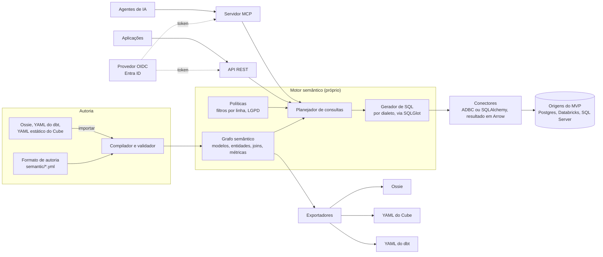

# Arquitetura

O motor semântico é próprio: ele lê o modelo, planeja cada consulta de métrica, gera o SQL no dialeto da origem e executa direto nela. Cube, dbt e Ossie são formatos de importação e exportação. Ver [ADR 0004](decisions/0004-motor-semantico-proprio.md) e [ADR 0007](decisions/0007-conectores-origens-identidade-e-importacao.md).

## Visão geral

## Componentes

| Componente | Responsabilidade | Tecnologia |
| --- | --- | --- |
| Formato de autoria | Onde o usuário modela entidades, dimensões, medidas e métricas | YAML em git, versionado (`version: 1`), com vocabulário do dbt; ver [modelo semântico](modelo-semantico.md) |
| Compilador e validador | Lê e valida o modelo, infere joins a partir das entidades e monta o grafo semântico | Python, Pydantic; o JSON Schema do formato é gerado dos modelos Pydantic |
| Ontologia | Glossário SKOS (conceitos, sinônimos, hierarquia) e regras de negócio ligadas aos modelos | Parte do grafo semântico; ver [ADR 0006](decisions/0006-ontologia-no-mvp.md) |
| Testes de regras | Executam os exemplos de cada regra de negócio em CI, sem acessar a origem | SQLGlot traduzindo para DuckDB |
| Planejador de consultas | Transforma um pedido (métricas, dimensões, filtros, granularidade de tempo) num plano lógico | Python; MetricFlow como referência de design |
| Gerador de SQL | Converte o plano em SQL no dialeto de cada origem | [SQLGlot](https://github.com/tobymao/sqlglot) (MIT) |
| Conectores | Executam o SQL, somente leitura, e devolvem o resultado sempre em Arrow | Interface `Connector` própria; ADBC por padrão, SQLAlchemy como reserva para origens sem driver ADBC maduro |
| Políticas | Filtros por linha a partir do contexto do usuário e regras de LGPD para colunas sensíveis | Parte do modelo semântico |
| API REST | Consultas de aplicações | FastAPI |
| Servidor MCP | Metadados e consultas para agentes de IA | SDK oficial de MCP, transporte HTTP |
| Intercâmbio | Importar dbt (formato atual e legado), Ossie e Cube (YAML estático); exportar Ossie, Cube e dbt | Python; ver [interoperabilidade](interoperabilidade-ossie.md) |

## Planejador de consultas

O planejador é a parte mais delicada do produto, porque é onde um número pode sair errado.

**Entrada:** um pedido como "receita e ticket médio por região do cliente, por mês, em 2026".

**Passos:**

1. **Resolver nomes:** cada métrica, dimensão e filtro do pedido vira um membro do grafo semântico. Termos de negócio passam pelo glossário: um sinônimo leva ao conceito, e o conceito leva ao membro ou à regra de negócio que o define.
2. **Encontrar o caminho de joins:** a partir do modelo dono de cada medida, percorrer as entidades até os modelos das dimensões pedidas, inclusive com vários saltos. Caminho ambíguo é erro, nunca escolha silenciosa.
3. **Evitar multiplicação de linhas (fan-out):** quando medidas de modelos diferentes aparecem juntas, cada uma é agregada no próprio grão, numa subconsulta, antes de juntar os resultados pelas dimensões em comum. É a mesma estratégia do MetricFlow.
4. **Aplicar políticas:** filtros por linha do contexto do usuário entram no plano; colunas marcadas como sensíveis só podem aparecer agregadas.
5. **Gerar SQL:** o plano é convertido no dialeto da origem pelo SQLGlot, incluindo truncamento de datas por granularidade.
6. **Executar e limitar:** o conector executa, com limite de linhas e tempo máximo configuráveis.

## Ferramentas do servidor MCP

| Ferramenta | O que devolve |
| --- | --- |
| `search_concepts` | Conceitos do glossário que casam com os termos da pergunta, incluindo sinônimos, com o membro ou a regra de cada um |
| `explain` | A definição de uma métrica, conceito ou regra em linguagem natural: dono, vigência e lógica |
| `list_members` | Métricas, dimensões e regras disponíveis |
| `query` | O resultado de um pedido de métricas, já com políticas aplicadas |
| `show_sql` | O SQL que o motor gerou para um pedido |

## Fluxo de autoria

1. O usuário edita arquivos em `semantic/`, ou importa um modelo de Ossie, dbt ou Cube.
2. Num pull request, o CI roda o validador: referências inexistentes, caminhos de join ambíguos e métricas inválidas falham o build.
3. Na integração com a branch principal, o modelo é publicado para a API e o MCP.
4. O mesmo modelo pode ser exportado em Ossie, para o Cube ou para o dbt.

## Segurança

- **Contexto do usuário:** toda consulta chega com um token JWT emitido por um provedor OIDC externo (Entra ID primeiro; Keycloak, Okta e Auth0 pelo mesmo caminho). O Cosmos valida a assinatura pelo JWKS do provedor e não emite tokens. As declarações do token alimentam os filtros por linha definidos no modelo (por exemplo, a região ou a empresa do usuário).
- **Mapeamento de declarações:** o modelo declara em `user_context` cada campo de `$user` e de qual declaração do token ele vem; se faltar uma declaração exigida, a consulta é negada.
- **Agentes em nome do usuário:** o agente consulta com o token do usuário que perguntou (fluxo on-behalf-of), nunca com uma identidade de serviço genérica.
- **Modo de desenvolvimento:** chaves de API ligadas a um contexto de usuário fixo, só para uso local e auto-hospedado sem provedor de identidade.
- **LGPD:** colunas podem ser classificadas como dado pessoal ou dado pessoal sensível. Agentes nunca recebem o valor bruto dessas colunas, só agregados ou valores mascarados.
- **Credenciais das origens** ficam no Azure Key Vault, nunca no repositório.
- **Somente leitura:** o motor gera apenas `SELECT`, e os conectores usam usuários de banco sem permissão de escrita.

## Implantação

### Local

Um `docker compose` com a API, o servidor MCP e um Postgres de demonstração com dados de exemplo.

### Azure

| Recurso | Uso |
| --- | --- |
| Azure Container Apps | API REST e servidor MCP |
| Azure Database for PostgreSQL Flexible Server | Metadados do plano de controle (fase 3) |
| Azure Key Vault | Credenciais das origens e chaves do modo de desenvolvimento |
| Log Analytics | Logs, métricas e auditoria de consultas |
| Microsoft Entra ID | Provedor de identidade padrão; o Cosmos só valida os tokens |

Sem Cube API, refresh worker nem Cube Store: a infraestrutura do MVP é a menor possível.

## Fases posteriores

- **Cache de resultados:** guardar respostas de consultas repetidas, com expiração; candidatos a avaliar incluem DuckDB sobre Parquet no Azure Blob Storage.
- **Endpoint SQL compatível com Postgres:** para Power BI, Tableau e Excel conectarem direto. Até lá, quem precisa de BI exporta para o Cube.
- **Plano de controle:** contas, projetos, conexões, editor e playground.
