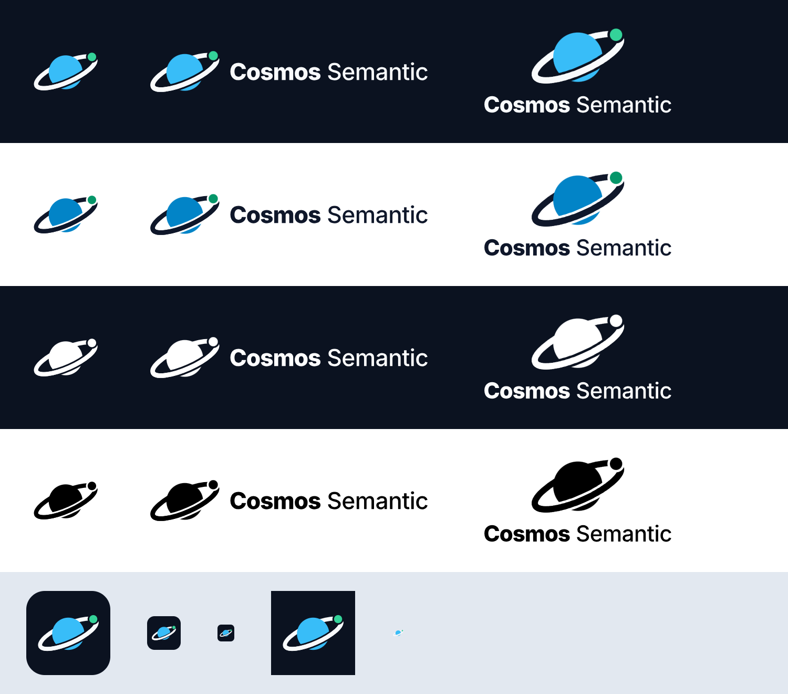

# Logo

The Cosmos Semantic logo for campaigns, print, slides, partner pages and events. It refines the original avatar ([`../linkedin/brand/logo-400.png`](../linkedin/brand/logo-400.png)) without changing the idea: a sky-blue planet, a tilted ring and a small green moon. At large sizes the ring now passes behind the planet at the top and in front of it at the bottom, with a thin gap at each crossing, so the mark reads as one object instead of two shapes stacked.



## Files

All SVGs are self-contained: the wordmark is converted to outlines, so they need no font. Use the SVG whenever the tool accepts it; use the PNGs (transparent background) otherwise.

| Version | Use it for | SVG | PNG |
| --- | --- | --- | --- |
| Horizontal | The default: headers, slides, banners, sponsor walls | `cosmos-semantic-horizontal-<theme>.svg` | `png/…-2000w.png`, `png/…-4000w.png` |
| Stacked | Square or tall spaces: posters, booth panels, end cards of videos | `cosmos-semantic-stacked-<theme>.svg` | `png/…-2000w.png`, `png/…-4000w.png` |
| Mark | Where the name is already present, or space is tight | `cosmos-semantic-mark-<theme>.svg` | `png/…-1024.png`, `png/…-2048.png` |
| Icon | App icons, favicons (rounded navy square) | `cosmos-semantic-icon.svg` | `png/…-1024.png`, `png/…-2048.png` |
| Avatar | Social profile pictures (square navy; the platform crops it) | `cosmos-semantic-avatar.svg` | `png/…-1024.png`, `png/…-2048.png` |

| Theme | Background | Colors |
| --- | --- | --- |
| `dark` | Navy or any dark background (the brand default) | Planet `#38bdf8`, ring and text `#f8fafc`, moon `#34d399` |
| `light` | White or light backgrounds, documents | Planet `#0284c7`, ring and text `#0f172a`, moon `#059669` |
| `white` | Photos and dark colored backgrounds, one color | All `#ffffff` |
| `black` | Print in one color, stamps, embossing | All `#000000` |

Brand background: navy `#0b1220`. Typeface: [Inter](https://rsms.me/inter/), ExtraBold for "Cosmos", Medium for "Semantic".

## Rules

- **Clear space:** keep at least the height of the moon's diameter times two empty on every side; the files already include a margin.
- **Minimum size:** horizontal 120 px (25 mm) wide; mark 20 px. Below that, use the icon.
- **Don't** recolor, stretch, rotate, add shadows or outlines, rearrange the mark and the name, or put the dark theme on a light background.
- The name is always "Cosmos Semantic", two words, capital C and S.

## Regenerating

[`build_logo.py`](build_logo.py) writes every SVG and PNG from the geometry and colors at the top of the file. It needs Inter's static TTFs (`inter-500.ttf`, `inter-800.ttf`) in a folder and Google Chrome:

```bash
uv run --no-project --with uharfbuzz --with fonttools --with playwright \
  python marketing/brand/build_logo.py path/to/inter-fonts
```
